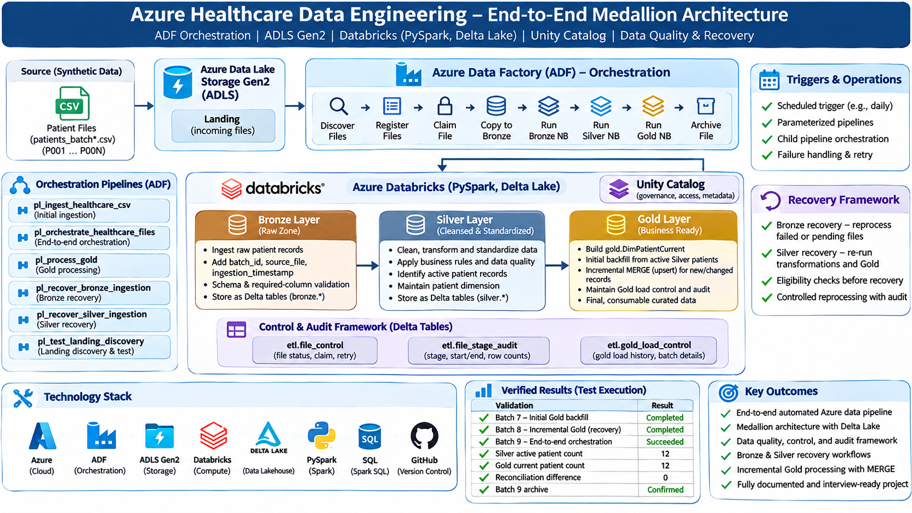
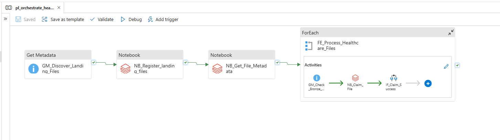
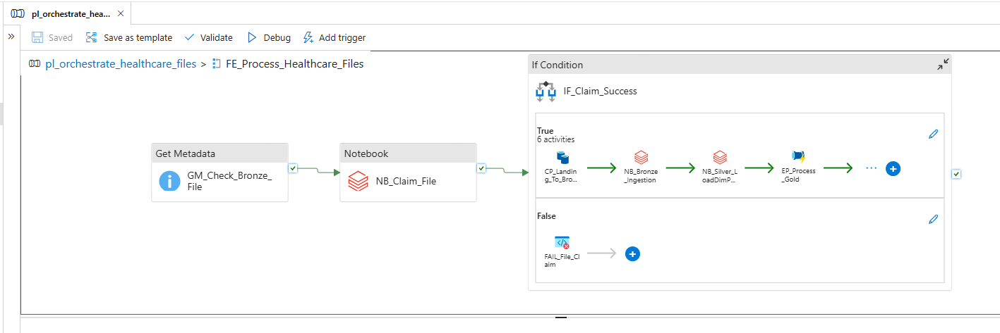
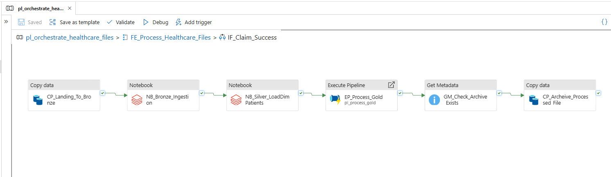
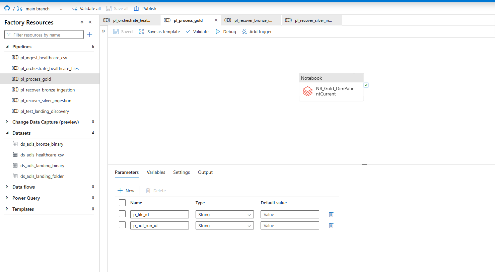
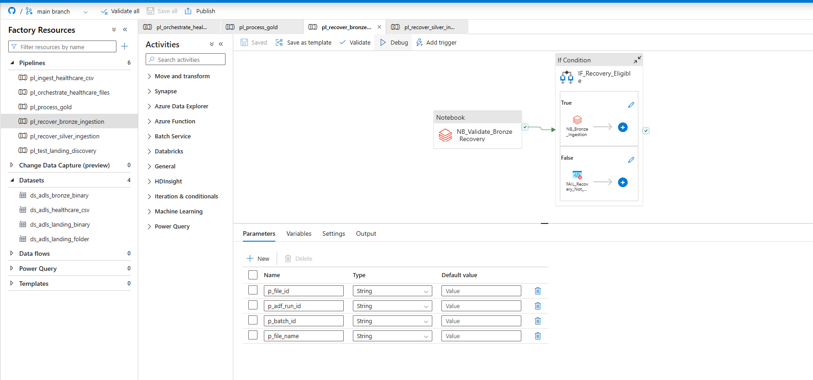
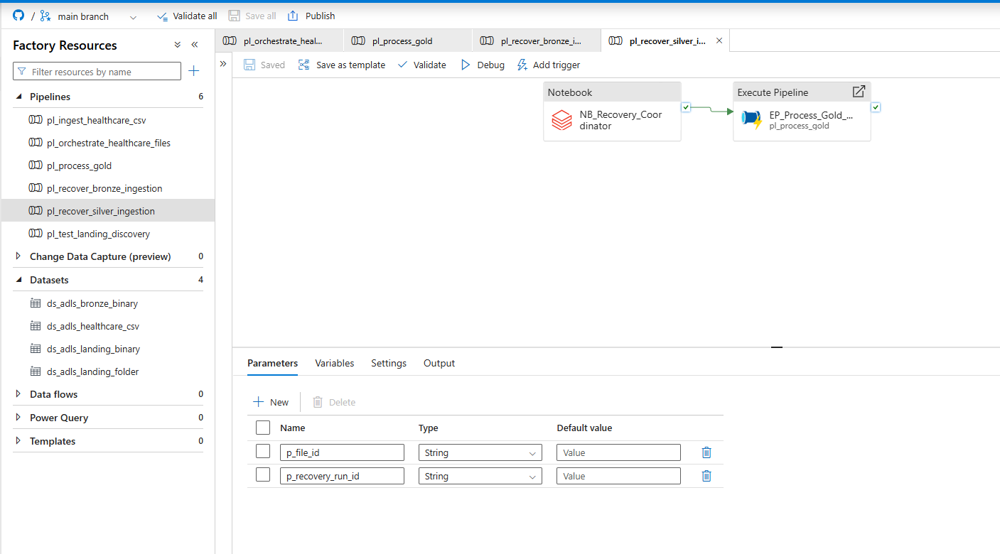
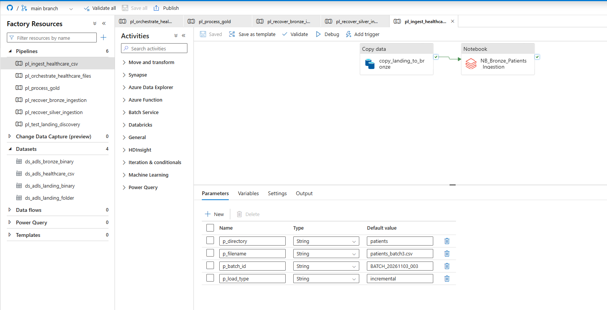

# Azure Healthcare Data Engineering — ADF Pipeline Documentation

## 1. Project Overview

This document describes the Azure Data Factory (ADF) orchestration framework implemented for the Azure Healthcare Data Engineering portfolio project.

The solution uses Azure Data Factory, Azure Data Lake Storage Gen2 (ADLS Gen2), Azure Databricks, PySpark, Delta Lake, and Unity Catalog to process synthetic healthcare patient records through Bronze, Silver, and Gold layers.

The project demonstrates:

- Metadata-driven file ingestion
- File discovery and registration
- File claiming and processing controls
- Parameterized ADF pipelines and Databricks notebooks
- Incremental processing and Delta MERGE
- Stage-level auditing and validation
- Bronze and Silver recovery workflows
- Successful-file archiving
- End-to-end reconciliation

**Project status:** Completed and tested in November 2026.

---

## 2. Architecture Overview



### End-to-End Processing Flow

```text
Synthetic Patient CSV Files
          |
          v
ADLS Gen2 Landing Container
          |
          v
ADF: Discover Landing Files
          |
          v
Databricks: Register Files
          |
          v
Databricks: Retrieve Pending Files
          |
          v
ADF: ForEach File
          |
          v
Check Bronze File / Claim File
          |
          v
Claim Successful?
    |            |
   Yes           No
    |            |
    v            v
Copy to Bronze   Fail Activity
    |
    v
Bronze Ingestion Notebook
    |
    v
Silver Patient Dimension Notebook
    |
    v
Execute Gold Child Pipeline
    |
    v
Gold Patient Dimension Notebook
    |
    v
Check Archive Destination
    |
    v
Copy Processed Source to Archive
```

The architecture uses a file-control framework to track processing state and prevent ordinary discovery from repeatedly selecting completed files.

---

## 3. Azure Resources and Technologies

| Component | Purpose |
|---|---|
| Azure Data Factory | Pipeline orchestration and activity dependencies |
| ADLS Gen2 | Landing, Bronze, and archive file storage |
| Azure Databricks | PySpark-based data processing |
| Delta Lake | Transactional Bronze, Silver, and Gold tables |
| Unity Catalog | Catalog and schema organization |
| Spark SQL | Data validation and transformations |
| GitHub | Version control for notebooks and ADF JSON |
| ADF Monitoring | Pipeline execution and activity-run visibility |

### Data Organization

The project uses the Unity Catalog catalog:

`dbw_healthcare_de_dev`

Relevant schemas include:

- `bronze` — Raw ingestion
- `silver` — Transformed patient dimension
- `gold` — Current patient dimension
- `etl` — Control and audit tables

---

## 4. Main Orchestration Pipeline

### Pipeline: `pl_orchestrate_healthcare_files`

**Purpose:** Automatically discover eligible patient CSV files, process them through the Medallion architecture, and archive successfully processed source files.



### Activity Sequence

| Order | Activity | Responsibility |
|---|---|---|
| 1 | `GM_Discover_Landing_Files` | Discover files in the landing directory |
| 2 | `NB_Register_landing_files` | Register discovered files in the control framework |
| 3 | `NB_Get_File_Metadata` | Retrieve eligible pending files |
| 4 | `FE_Process_Healthcare_Files` | Process selected files sequentially |
| 5 | `GM_Check_Bronze_File` | Check Bronze destination file metadata |
| 6 | `NB_Claim_File` | Attempt to claim the file for processing |
| 7 | `IF_Claim_Success` | Branch based on claim outcome |
| 8 | `CP_Landing_To_Bronze` | Copy the source file into Bronze storage |
| 9 | `NB_Bronze_Ingestion` | Load and validate Bronze records |
| 10 | `NB_Silver_LoadDimPatients` | Transform and load the Silver patient dimension |
| 11 | `EP_Process_Gold` | Invoke the Gold child pipeline |
| 12 | `GM_Check_Archive_Exists` | Inspect the archive destination |
| 13 | `CP_Archive_Processed_File` | Copy the processed source file to the archive |

### Landing File Discovery

`GM_Discover_Landing_Files` reads the configured landing directory and retrieves child items.

The registration notebook records discovered files and uses duplicate-registration protections.

`NB_Get_File_Metadata` selects files matching the following processing conditions:

```sql
is_enabled = TRUE
AND pipeline_status = 'PENDING'
AND processing_stage = 'REGISTERED'
```

This ensures that only eligible files are passed to the processing loop.

### File Claim and Conditional Processing



The pipeline uses `NB_Claim_File` to perform file-claim processing before ingestion.

The `IF_Claim_Success` activity controls the execution path:

- **True:** Continue through Bronze, Silver, Gold, and archiving.
- **False:** Execute `FAIL_File_Claim`.

The `FE_Process_Healthcare_Files` activity was configured for sequential processing during project testing.

### Bronze, Silver, and Gold Execution



After a successful claim:

1. ADF copies the source file from Landing to Bronze.
2. Databricks performs Bronze ingestion and validation.
3. Databricks applies Silver patient-dimension processing.
4. ADF invokes the Gold child pipeline and waits for completion.
5. ADF checks the archive destination.
6. ADF copies the successfully processed source file into the archive.

### Archiving Behavior

The project uses copy-only archiving.

Source files remain in the Landing container after successful processing.

The archive destination is:

`landing/archive/patients/`

The `GM_Check_Archive_Exists` activity retrieves destination metadata. In the implemented workflow, it does not independently prevent overwriting an existing archive file.

This distinction is important when evaluating the pipeline's production-readiness.

---

## 5. Gold Processing Pipeline

### Pipeline: `pl_process_gold`

**Purpose:** Execute the Gold patient dimension processing notebook.



### Pipeline Parameters

| Parameter | Description |
|---|---|
| `p_file_id` | File identifier being processed |
| `p_adf_run_id` | Owning orchestration run identifier |

The main orchestration pipeline passes the following expressions:

```text
p_file_id     = @item().file_id
p_adf_run_id  = @pipeline().RunId
```

### Gold Processing Logic

The Gold notebook:

1. Validates the file and processing context.
2. Checks the relevant Silver processing audit.
3. Determines whether Gold initialization has completed.
4. Performs an initial backfill when required.
5. Uses incremental Delta MERGE for subsequent processing.
6. Writes stage-level audit information.
7. Updates file-processing completion status.

### Gold Output

`gold.DimPatientCurrent`

This table represents the current patient records required for downstream analytical consumption.

### Gold Initialization Control

The implementation uses:

`etl.gold_load_control`

This table supports tracking whether the initial Gold backfill has been completed.

---

## 6. Bronze Recovery Pipeline

### Pipeline: `pl_recover_bronze_ingestion`

**Purpose:** Provide a controlled recovery path for eligible Bronze ingestion failures.



### Pipeline Parameters

| Parameter | Description |
|---|---|
| `p_file_id` | File identifier |
| `p_adf_run_id` | Associated ADF run identifier |
| `p_batch_id` | Batch identifier |
| `p_file_name` | Source filename |

### Activity Flow

```text
NB_Validate_Bronze_Recovery
             |
             v
     IF_Recovery_Eligible
         /         \
       True        False
        |            |
        v            v
 NB_Bronze_       FAIL_Recovery_
 Ingestion        NOT_Eligible
```

### Recovery Design

The recovery validation notebook determines whether the file is eligible for Bronze recovery.

When eligible, the pipeline invokes the Bronze ingestion notebook.

When ineligible, the pipeline follows an explicit failure path rather than silently continuing.

This design separates recovery eligibility checking from normal file discovery and processing.

---

## 7. Silver Recovery Pipeline

### Pipeline: `pl_recover_silver_ingestion`

**Purpose:** Coordinate recovery processing and invoke the Gold processing pipeline.



### Pipeline Parameters

| Parameter | Description |
|---|---|
| `p_file_id` | File identifier |
| `p_recovery_run_id` | Recovery execution identifier |

### Activity Flow

```text
NB_Recovery_Coordinator
          |
          v
EP_Process_Gold
          |
          v
pl_process_gold
          |
          v
NB_Gold_DimPatientCurrent
```

### Recovery Design

The recovery coordinator notebook handles recovery coordination before invoking the Gold child pipeline.

The workflow demonstrates how recovery processing can reuse existing pipeline components instead of duplicating the Gold notebook orchestration.

The precise eligibility and state-transition rules are implemented in the Databricks recovery coordinator notebook.

---

## 8. Initial Healthcare CSV Ingestion

### Pipeline: `pl_ingest_healthcare_csv`

**Purpose:** Provide a parameterized Landing-to-Bronze ingestion workflow.



### Activity Flow

```text
copy_landing_to_bronze
          |
          v
NB_Bronze_Patients_Ingestion
```

### Pipeline Parameters

| Parameter | Example configuration |
|---|---|
| `p_directory` | `patients` |
| `p_filename` | `patients_batch3.csv` |
| `p_batch_id` | `BATCH_20261103_003` |
| `p_load_type` | `incremental` |

This pipeline was part of the project's earlier ingestion development.

The main orchestration pipeline provides the broader metadata-driven processing framework.

---

## 9. Landing Discovery Test Pipeline

### Pipeline: `pl_test_landing_discovery`

This supporting pipeline was created for testing landing file discovery behavior during development.

Its detailed activity configuration should be reviewed in the corresponding ADF pipeline JSON.

---

## 10. File Control and Audit Framework

### File Control

`etl.file_control`

The file-control framework tracks file identifiers, batch identifiers, source paths, owning ADF runs, processing stages, and pipeline status.

Important processing states include:

- `REGISTERED`
- `PENDING`
- `IN_PROGRESS`
- `COMPLETED`

### Stage Audit

`etl.file_stage_audit`

The stage audit framework records processing outcomes and supports validation of stage completion.

### Gold Initialization

`etl.gold_load_control`

Tracks the Gold initialization process and supports the distinction between initial backfill and incremental processing.

### Operational Benefits

- Traceability across file-processing stages
- Visibility into incomplete and completed files
- Controlled file selection
- Support for targeted recovery
- Evidence for pipeline troubleshooting

---

## 11. Incremental Processing and Delta MERGE

The Gold layer supports two processing modes.

### Initial Backfill

During initialization, the Gold notebook loads the active patient records from the Silver dimension.

### Incremental Processing

After initialization, subsequent batches use incremental Delta MERGE operations to maintain current patient records.

This avoids rebuilding the complete Gold dimension for every new file.

The project also maintains batch and file identifiers for processing traceability.

---

## 12. Testing and Validation

### Batch 7 — Initial Gold Backfill

The initial Gold backfill completed successfully.

The Gold patient dimension initially contained 10 active patient records.

### Batch 8 — Gold Recovery

During Batch 8 testing, the main orchestration encountered an incorrect child-pipeline parameter reference:

```text
Incorrect: @item().p_file_id
Correct:   @item().file_id
```

The parameter mapping was corrected and published.

The Gold child pipeline was then executed separately using the original file identifier and owning ADF run identifier.

The Gold processing activity succeeded, and the file-control record was verified as:

```text
processing_stage = COMPLETED
pipeline_status  = COMPLETED
```

Batch 8 was subsequently archived.

### Batch 9 — Final End-to-End Validation

The final test successfully executed the main ADF orchestration pipeline.

The user-verified results were:

| Validation | Result |
|---|---|
| Main ADF pipeline | Succeeded |
| File discovery and registration | Succeeded |
| File claim | Succeeded |
| Bronze processing | Succeeded |
| Silver processing | Succeeded |
| Gold processing | Succeeded |
| Source-file archive | Confirmed |
| Silver active patient records | 12 |
| Gold current patient records | 12 |
| Record-count difference | 0 |

The Silver-to-Gold reconciliation confirmed matching active patient counts.

These results validate the implemented workflow using the project's synthetic development dataset.

---

## 13. Troubleshooting and Lessons Learned

### Azure Storage Connectivity

The project encountered storage authentication and networking challenges during development.

These were investigated through configuration changes, access validation, and development-environment troubleshooting.

### Parameter Mapping

ADF child pipelines require correct parameter references.

The Batch 8 failure demonstrated the importance of validating the structure of ForEach items before referencing their properties.

### Recovery Without Reprocessing Earlier Stages

The Batch 8 Gold recovery demonstrated that a failed downstream stage could be completed separately without repeating the entire ingestion sequence.

### Databricks Permissions

Unity Catalog schema permissions were configured to support the project's validation queries.

### Cost Management

Azure Databricks and networking resources contributed to development costs.

After final testing, Databricks compute was terminated and the Azure subscription was canceled to prevent additional infrastructure usage.

---

## 14. Repository References

### ADF Source Code

`adf/pipeline/`

Contains the ADF pipeline JSON definitions.

### Databricks Notebooks

`databricks/bronze/`

`databricks/silver/`

`databricks/gold/`

`databricks/orchestration/`

### Architecture and Screenshots

`docs/architecture/`

`docs/screenshots/adf/`

---

## 15. Production Considerations

This project is a portfolio implementation rather than a production healthcare deployment.

Potential production enhancements include:

- Stronger archive overwrite protection
- Automated operational alerting
- More comprehensive recovery testing
- Formal infrastructure-as-code deployment
- Automated CI/CD validation
- Additional schema evolution and data quality tests
- Improved secret management and network hardening
- Larger-scale performance and concurrency testing

---

## 16. Conclusion

This project demonstrates the development of an end-to-end Azure Data Engineering workflow using ADF orchestration, ADLS Gen2, Databricks, PySpark, Delta Lake, and Unity Catalog.

It includes metadata-driven file discovery, control-based processing, Bronze/Silver/Gold transformations, incremental Gold maintenance, auditing, recovery workflows, and source-file archiving.

The final Batch 9 test completed successfully, with 12 active Silver patients and 12 current Gold patients.

**All test data is synthetic.** The implementation is intended for technical learning, portfolio demonstration, and Data Engineering interview preparation.
