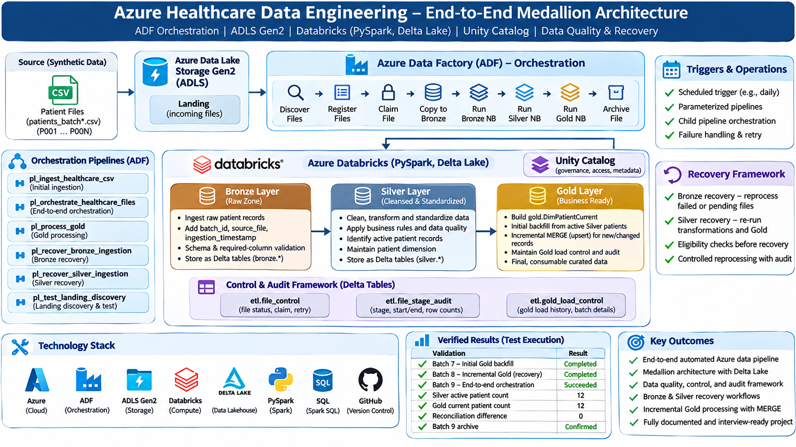
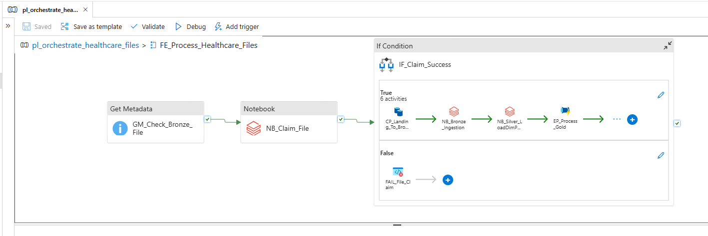
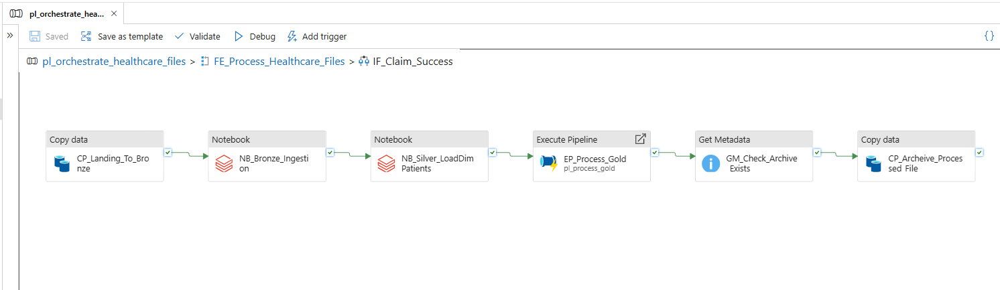
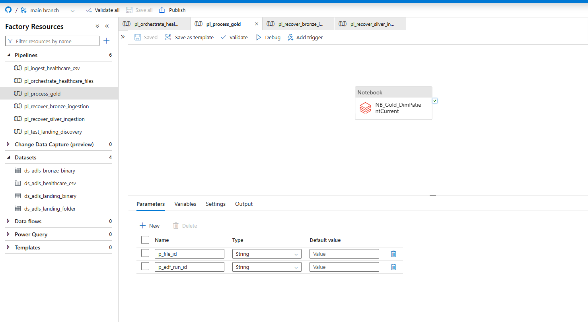
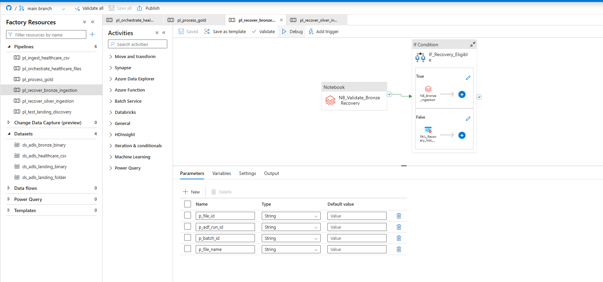
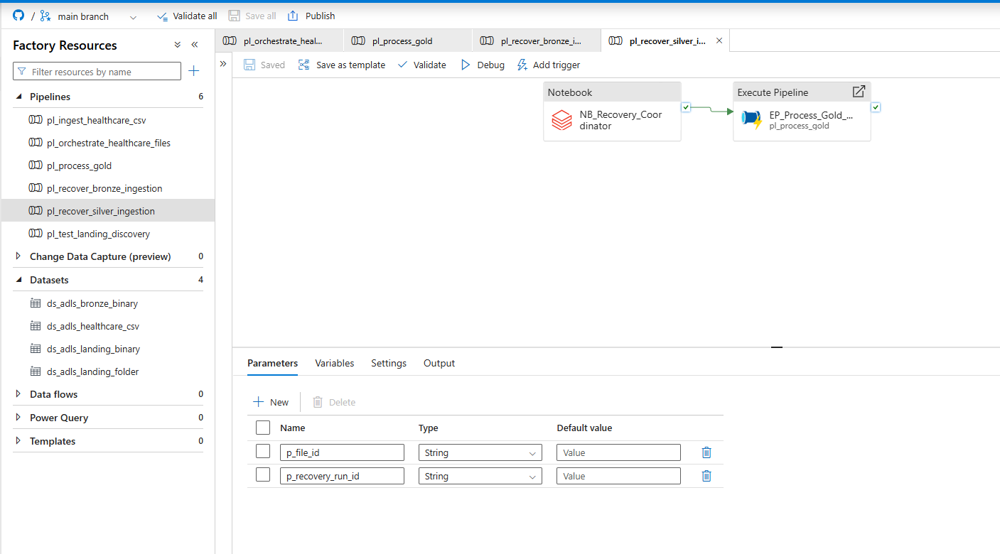

# Azure Healthcare Data Engineering — Databricks Notebook Documentation

## 1. Scope and evidence

This document describes the **notebooks and SQL scripts actually included** in the `azure-healthcare_data-engineering` GitHub repository ZIP reviewed on November 16, 2026. The dataset is synthetic; this is a development/portfolio implementation, not a deployed production healthcare platform. Code inspection verifies implementation, **not** successful execution of every recovery branch.

**Platform:** Azure Data Factory (ADF), ADLS Gen2, Azure Databricks, PySpark, Delta Lake, Unity Catalog, Spark SQL. **Catalog used in source:** `dbw_healthcare_de_dev`.



## 2. Notebook inventory

| Source notebook | Role | Key inputs / outputs |
|---|---|---|
| `databricks/bronze/01_healthcare_bronze_ingestion.ipynb` | Bronze CSV ingestion, quality gates, ownership and audit handling | Widgets include `file_id`, `adf_run_id`, `batch_id`, `source_container`, `source_folder`, `file_name`, `storage_account`, `load_type`, `target_schema`, `target_table`; writes `bronze.patients_raw` |
| `databricks/bronze/02_file_control_orchestration.ipynb` | Retrieve pending, registered files for ADF | Reads `etl.file_control`; returns JSON using `dbutils.notebook.exit` |
| `databricks/bronze/03_file_claim_orchestration.ipynb` | Validate file state and claim it for one ADF run | Widgets `file_id`, `adf_run_id`, `bronze_file_exists`; consults `etl.file_control` and claim procedure; returns JSON |
| `databricks/bronze/04_register_landing_files.ipynb` | Register discovered Landing files | Widgets `storage_account`, `source_container`, `source_folder`, `discovered_files_json`, `adf_run_id`; Delta MERGE into `etl.file_control` |
| `databricks/bronze/05_validate_bronze_recovery.ipynb` | Gate targeted Bronze recovery | Widgets `file_id`, `adf_run_id`, `batch_id`, `file_name`; validates control state, Bronze file existence and absence of existing Bronze Delta records |
| `databricks/bronze/06_parquest_file_demo.ipynb` | Separate Parquet demonstration | Learning/demo notebook; not a core orchestration stage |
| `databricks/silver/01_silver_load_dimpatients.ipynb` | Validate and load Silver dimension | Widgets `file_id`, `adf_run_id`; invokes `silver.usp_LoadDimPatients`; validates `silver.DimPatients` |
| `databricks/gold/01_gold_dim_patient_current.ipynb` | Initialize and incrementally maintain current-patient Gold table | Widgets `file_id`, `adf_run_id`; reads Silver and Bronze; writes `gold.DimPatientCurrent`; uses `etl.gold_load_control` |
| `databricks/orchestration/01_get_recovery_files.ipynb` | Inspect file-control and stage-audit data for recovery candidates | Reads `etl.file_control` and `etl.file_stage_audit`; review notebook code for selection criteria before automating |
| `databricks/orchestration/02_recovery_coordinator.ipynb` | Execute guarded Silver recovery | Widgets `recovery_mode`, `file_id`, `recovery_run_id`; invokes Silver stored procedure and validates results |

The repository also contains **13 SQL-script notebooks** in `databricks/SQL Scripts/`.

## 3. File discovery, registration and claiming

### Registration — `04_register_landing_files`

The notebook parses the ADF Get Metadata JSON array, checks each discovered filename (including unsafe-name rejection), prepares file-control registration records, and performs a **Delta MERGE** into `etl.file_control`. Its purpose is to make landing-file discovery idempotent at the registration level and provide metadata for later file claiming.

### Eligible-file selection — `02_file_control_orchestration`

The actual selection query is:

```sql
SELECT file_id, batch_id, source_container, source_folder,
       file_name, source_file, load_type, processing_stage,
       pipeline_status, retry_count
FROM dbw_healthcare_de_dev.etl.file_control
WHERE is_enabled = TRUE
  AND pipeline_status = 'PENDING'
  AND processing_stage = 'REGISTERED'
ORDER BY registered_at, file_id;
```

The notebook serializes the result as `{"file_count": ..., "files": [...]}` and returns it to ADF with `dbutils.notebook.exit`.

### Claiming — `03_file_claim_orchestration`

The notebook requires a `file_id` and `adf_run_id`, validates the `bronze_file_exists` parameter, checks the control record, calls the file-claim stored procedure, and verifies the resulting ownership/state before returning its result. The ADF `IF_Claim_Success` branch uses that result to decide whether to continue ingestion.



## 4. Bronze ingestion — `01_healthcare_bronze_ingestion`

**Input:** CSV file in the configured Bronze storage location, plus ADF/file-control metadata.

**Output:** `dbw_healthcare_de_dev.bronze.patients_raw` (Delta).

The notebook:

1. Reads parameter widgets and constructs the input and target locations.
2. Loads CSV data and adds processing metadata such as file and batch identifiers.
3. Validates required columns and nonempty input.
4. Rejects missing/null patient IDs and duplicate patient IDs within the incoming dataset.
5. Checks load type and target-table existence/compatibility.
6. Validates file ownership against `etl.file_control`.
7. Starts and updates stage audit records through `etl.usp_manage_stage_audit`.
8. Writes Delta data and performs post-write verification; failures raise errors rather than reporting success.

**Implementation note:** The source has multiple validation and write sections, reflecting iterative development. Before treating this as a reusable production notebook, consolidate repeated checks and verify the complete execution path with automated tests.



## 5. Silver dimension — `01_silver_load_dimpatients`

**Input:** `bronze.patients_raw`, `file_id`, `adf_run_id`.

**Output:** `silver.DimPatients`, stage audit and file-control updates.

The notebook validates file ownership and Bronze batch data (including counts and unique patient identifiers), starts the Silver stage audit, and calls:

```sql
CALL dbw_healthcare_de_dev.silver.usp_LoadDimPatients(:file_id);
```

It then reconciles Bronze patient IDs against active Silver records, checks that each affected patient has exactly one active dimension row, verifies the stage audit and checks the updated file-control stage.

The companion SQL procedure `usp_LoadDimPatients` implements **slowly changing dimension (SCD Type 2)-style** handling, including expiring previous versions and inserting changed/current versions via MERGE logic. This is distinct from the Gold table, which is a current-state projection.

**Operational caution:** The notebook explicitly warns that a stored procedure may have partially committed before an exception. A failed or ambiguous execution should be reconciled before retrying.

## 6. Gold current dimension — `01_gold_dim_patient_current`

**Input:** `silver.DimPatients` and changed patient IDs from the current file/batch in `bronze.patients_raw`.

**Output:** `gold.DimPatientCurrent` and `etl.gold_load_control`.

The notebook first requires exactly one enabled, `IN_PROGRESS` file-control record owned by the supplied ADF run at stage `GOLD`. It also requires a successful Silver audit.

It creates the Gold schema/table and Gold initialization control table if missing, then verifies that Silver has exactly one active version per patient, valid patient identifiers, and no duplicate active patients.

**Initial load:** Uses current active Silver patient records for the first Gold population, with initialization tracked in `etl.gold_load_control`.

**Incremental load:** Identifies patient IDs changed in the current Bronze batch, joins those IDs to current active Silver records, and applies a **Delta Lake MERGE** to maintain the current-state Gold dimension.

**Post-write checks:** Compare expected and actual patient counts, detect duplicate Gold patient IDs, and compare patient attributes with the active Silver source; audit and file-control transitions are verified before completion.



## 7. Bronze recovery — `05_validate_bronze_recovery`

The notebook enforces the following eligibility conditions:

- All four parameters (`file_id`, `adf_run_id`, `batch_id`, `file_name`) must be provided.
- Exactly one matching enabled file-control row must be `IN_PROGRESS` at processing stage `BRONZE` and owned by the given run.
- The registered source path must start with `abfss://landing@`.
- The corresponding file must exist in the Bronze storage location.
- No matching records may already exist in `bronze.patients_raw` for that `file_id` or Bronze source path.

On success, the notebook returns JSON with `recovery_eligible: true`, the file/batch identifiers and Bronze path. On failed checks it raises an error. ADF then conditionally runs the Bronze ingestion notebook.



**Evidence boundary:** The source confirms the checks are implemented; it does not by itself establish that all recovery scenarios were execution-tested.

## 8. Silver recovery — `02_recovery_coordinator`

The coordinator requires `recovery_mode = EXECUTE`, `file_id`, and `recovery_run_id`. It validates that the recovery run owns an enabled `IN_PROGRESS` file-control record at stage `SILVER`.

It also requires **one active Silver recovery audit** and, in the uploaded code, explicitly requires `attempt_number = 2` with an error message referring to **Batch 7**. This is a **batch-specific restriction** and should be generalized before claiming reusable Silver recovery across arbitrary batches.

Before reprocessing, it checks:

- Bronze records exist for the file/batch.
- Bronze patient IDs are non-null/nonblank and not duplicated.
- No Silver rows already exist for the same batch (otherwise reconciliation is required).
- Existing Silver history is structurally safe: one active record per relevant patient and no invalid closed-history rows.

The coordinator then calls `silver.usp_LoadDimPatients`, performs Bronze-to-Silver reconciliation and active-version validation, and updates/verifies the stage audit and file-control state. It deliberately avoids blindly retrying an uncertain partially committed stored-procedure execution.

The ADF Silver recovery pipeline subsequently invokes the Gold child pipeline.



## 9. SQL scripts in the repository

All paths below are relative to `databricks/SQL Scripts/`. These are Databricks SQL notebook exports (`.dbquery.ipynb`), not standalone `.sql` files.

| Script | Role in the repository |
|---|---|
| `Create ETL Schema.dbquery.ipynb` | ETL schema/control setup and development SQL checks |
| `Create Table etl.file_ingestion_audit.dbquery.ipynb` | Ingestion audit table definition |
| `Create Table etl.file_stage_audit.dbquery.ipynb` | Stage audit table definition |
| `Create Table silver.DimPatients.dbquery.ipynb` | Silver patient dimension table definition |
| `usp_LoadDimPatients.dbquery.ipynb` | Silver SCD Type 2 dimension loading and validation |
| `usp_claim_file.sql.dbquery.ipynb` | Claim eligible file-control records |
| `usp_claim_recovery.dbquery.ipynb` | Claim file for recovery processing |
| `usp_fail_file.dbquery.ipynb` | Record failed file processing |
| `usp_manage_stage_audit.dbquery.ipynb` | Start/complete/fail stage audit management |
| `usp_promote_patients_to_silver.dbquery.ipynb` | Separate Bronze-to-Silver MERGE procedure |
| `usp_retry_file.dbquery.ipynb` | Retry-related file-control updates |
| `usp_start_stage_audit.dbquery.ipynb` | Create stage audit attempt |
| `usp_update_file_stage.dbquery.ipynb` | Update file processing stage with audit-related checks |

**Source-of-truth distinction:** Several SQL scripts represent alternative or iterative development paths. Do not assume every script is invoked by the final ADF orchestration. The active Silver notebook specifically calls `silver.usp_LoadDimPatients`.

## 10. ADF integration

| ADF pipeline | Relevant notebook(s) |
|---|---|
| `pl_orchestrate_healthcare_files` | Register landing files, select pending files, claim file, Bronze ingestion, Silver load, Gold child pipeline |
| `pl_process_gold` | `gold/01_gold_dim_patient_current` |
| `pl_recover_bronze_ingestion` | Bronze recovery validation, then conditional Bronze ingestion |
| `pl_recover_silver_ingestion` | Silver recovery coordinator, then Gold child pipeline |
| `pl_ingest_healthcare_csv` | Initial Bronze ingestion workflow |
| `pl_test_landing_discovery` | Development/test support |

See [ADF Pipeline Documentation](ADF_PIPELINE_DOCUMENTATION.md) for activity-level orchestration and screenshots.

## 11. Observed validation outcomes

Earlier project testing recorded a successful **Batch 9 end-to-end ADF orchestration**, including archiving, with **12 active Silver patients and 12 current Gold patients (difference: 0)**. Batch 8 Gold processing was separately recovered by invoking the Gold child pipeline. These are **development test observations**, not assertions of production performance or proof that Bronze/Silver recovery pipelines passed every scenario.

## 12. Risks, hardening and next steps

1. Generalize the Silver recovery coordinator's hard-coded `attempt_number = 2` / Batch 7 assumption.
2. Add automated tests for normal, duplicate, partial-commit and recovery execution paths.
3. Review notebook execution order and remove duplicate or exploratory cells from operational notebooks.
4. Keep archive overwrite protection explicit; metadata checks alone are not an overwrite guard.
5. Use managed identity/secret scopes and restricted storage/network access for production.
6. Run a full security review of ADF linked services, notebooks, screenshots and Git history before publishing the repository.
7. Maintain clear separation between synthetic portfolio testing and production healthcare compliance claims.

---

*Prepared from the repository's actual Databricks notebooks and SQL-script exports. Source code was inspected; notebooks were not executed as part of this documentation review.*
